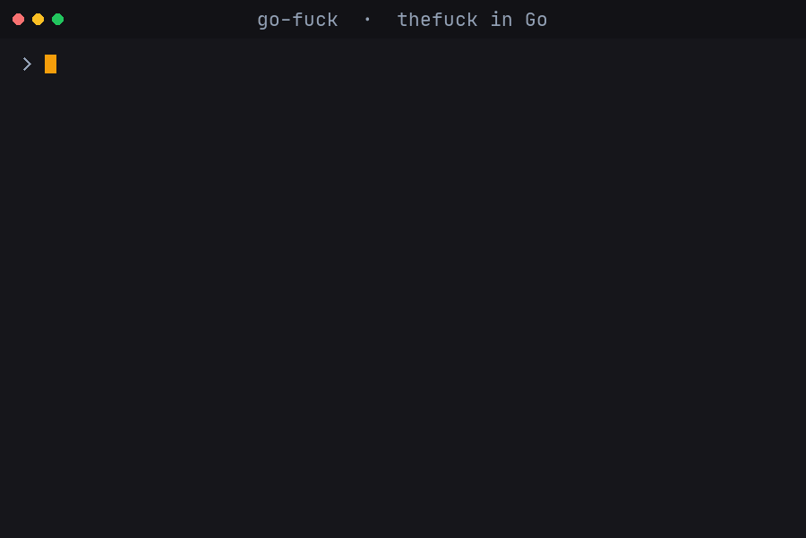

**go-fuck** 是一个用 Go 重写的 [thefuck](https://github.com/nvbn/thefuck)。命令敲错时输入 `fuck`，它会根据内置规则给出修正建议，确认后直接执行。

- **快**：纯 Go、零第三方依赖，启动和规则匹配都在毫秒级
- **全**：200+ 条内置规则，覆盖 git、npm/pnpm/yarn、uv、cargo、kubectl、gh、PowerShell 等
- **跨平台**：Linux、macOS、Windows，支持 bash / zsh / fish / tcsh / PowerShell
- **可选 instant mode**：直接读取终端日志，不再重跑上一条命令

## 演示



## 安装

Homebrew（macOS / Linux）：

```bash
brew tap leafevans/go-fuck https://github.com/leafevans/go-fuck
brew trust leafevans/go-fuck
brew install go-fuck
```

Scoop（Windows）：

```powershell
scoop bucket add go-fuck https://github.com/leafevans/go-fuck
scoop install go-fuck
```

Arch Linux（AUR）：

```bash
yay -S go-fuck
```

Go 工具链：

```bash
go install github.com/leafevans/go-fuck/cmd/go-fuck@latest
```

也可以直接从 [releases](https://github.com/leafevans/go-fuck/releases) 下载对应平台的压缩包，每个版本都附有 `checksums.txt`。

## 快速开始

安装后执行一次 shell 配置：

```bash
go-fuck --setup
```

重新加载 shell 配置（bash 为 `source ~/.bashrc`，zsh 为 `source ~/.zshrc`，PowerShell 为 `. $PROFILE`），然后随便敲错一条命令，再输入：

```bash
fuck
```

## 反馈

遇到问题或想加规则，欢迎开 [Issue](https://github.com/leafevans/go-fuck/issues)；如果这个工具帮到了你，欢迎在 GitHub 上点个 Star ⭐。

## 链接

- [GitHub 仓库](https://github.com/leafevans/go-fuck)
- [完整规则与配置说明](https://github.com/leafevans/go-fuck#readme)
- [最新版本](https://github.com/leafevans/go-fuck/releases)
- [从 thefuck 迁移](https://github.com/leafevans/go-fuck/blob/main/UPGRADING.md)
- [参与贡献](https://github.com/leafevans/go-fuck/blob/main/CONTRIBUTING.md)

## 许可证

MIT